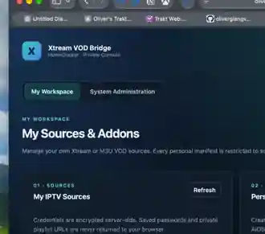
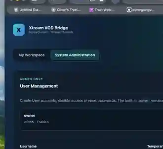
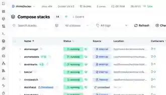

# HomeDocker UI screenshots — v0.6.0

The images under this directory are **operator-provided HomeDocker screenshots dated 2026-10-16**, trimmed for presentation. They are production UI evidence, not fabricated mockups and not proof of untested provider playback.

- 
  `ui-workspace.webp`: My Workspace → My Sources & Addons, IPTV Sources and Personal Manifests. Shows a provider labeled *untested* and a still-empty personal manifest list — **do not call this completed end-to-end testing**.
- 
  `ui-admin.webp`: System Administration → User Management / Operations at a glance. Catalog counts are a single historical snapshot.
- 
  `dockhand-internal.webp`: Dockhand Compose stacks list, one `xtream-vod-unified` running with **Source: Internal**; confirms adoption/registration, not future redeploy viability.

Screenshots intentionally exclude browser credential suggestions and most browser chrome. They contain no live passwords, tokens or private signed playback URLs. They must be checked again if reused in a public issue.
